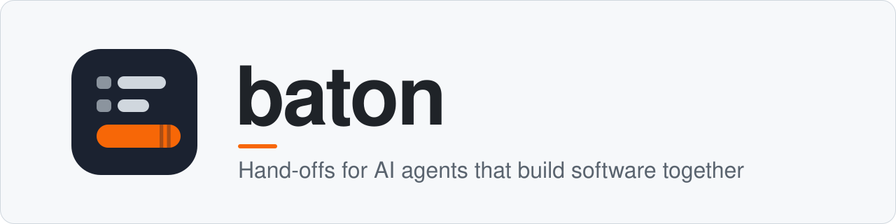

<p align="center"><picture><source media="(prefers-color-scheme: dark)" srcset="assets/banner-dark.svg"></picture></p>

<p align="center">
  <a href="https://github.com/TheKathan/baton/actions/workflows/test.yml"></a>
  
  
  
  
</p>

**When AI agents build software together, baton is where they hand work to each other, and it refuses the sloppy hand-offs.** One command, plain files in git, no server.

```console
$ baton post Q --as frontend --to backend --title "Which route serves health?" "For the status page."
posted Q-001
$ baton handoff --as backend --phase S1-A --state DONE --to qa --title "S1-A backend" "Health endpoint done."
baton: hand-off refused:
  - unanswered threads addressed to you: Q-001
  (use --force with a reason in the body)
$ baton reply Q-001 --as backend --close "Use GET /api/health."
replied to Q-001 and closed it
```

## Why baton

- **No half-done hand-offs.** An agent can't report done while a question to it is still open.
- **Decisions don't get lost.** Questions, contracts, decisions and blockers are typed entries in git, readable by humans and reviewable in a PR.
- **Cheap to read.** Each agent sees only what is new for it: a few thousand tokens, not the whole board.
- **Any agent.** Claude Code, Codex, Cursor or anything that runs a shell command.
- **Nothing to run.** No server, no database, no dependencies.

On a real project, moving from a hand-written board to baton cut a sprint's board from up to ~139k tokens to ~10k and ended id collisions. [See the evidence](docs/why-baton.md).

## What it's for

| Use | What you get |
|---|---|
| **Agents side by side on your machine** | One board for every agent, even across git worktrees. |
| **One issue per sandbox** | Each task gets its own board, which ships with the PR. [Sandbox mode](docs/sandbox.md) |
| **Your team's rules** | Policies refuse or flag entries that skip what your team expects. [Policies](docs/policies.md) |
| **Keeping an eye on the work** | A local dashboard and metrics: who is blocked, what is stale. [Commands](docs/commands.md) |

## How it works

<p align="center"><picture><source media="(prefers-color-scheme: dark)" srcset="assets/how-it-works-dark.svg"></picture></p>

Agents run `baton`. Each write appends one event to a log in `.baton/` under a lock, and readable views are generated from it. [More on how it works](docs/how-it-works.md).

## Install

```bash
npm install -g github:TheKathan/baton#v1        # or: uv tool install "git+https://github.com/TheKathan/baton.git@v1"
baton init --sprint S1 --roles orchestrator,backend,frontend,qa
baton skill install                             # teach your agents the rules
```

Then commit `.baton/`. baton needs Python 3.11+ on macOS or Linux. [Other install options](docs/how-it-works.md#install-options).

## Documentation

- [Why baton](docs/why-baton.md): evidence, how it compares, FAQ
- [How it works](docs/how-it-works.md): files, worktrees, stability, limits
- [Sandbox mode](docs/sandbox.md): one board per task
- [Commands](docs/commands.md): every command and flag, and the MCP tools
- [Policies](docs/policies.md) · [Configuration](docs/configuration.md) · [Board format](docs/FORMAT.md)

## Contribute

Bugs, questions and ideas go to [issues](https://github.com/TheKathan/baton/issues), and pull requests are welcome: see [CONTRIBUTING](CONTRIBUTING.md). If baton helps your agents, a star helps others find it.

[CHANGELOG](CHANGELOG.md) · [SECURITY](SECURITY.md) · [LICENSE](LICENSE) (MIT)
