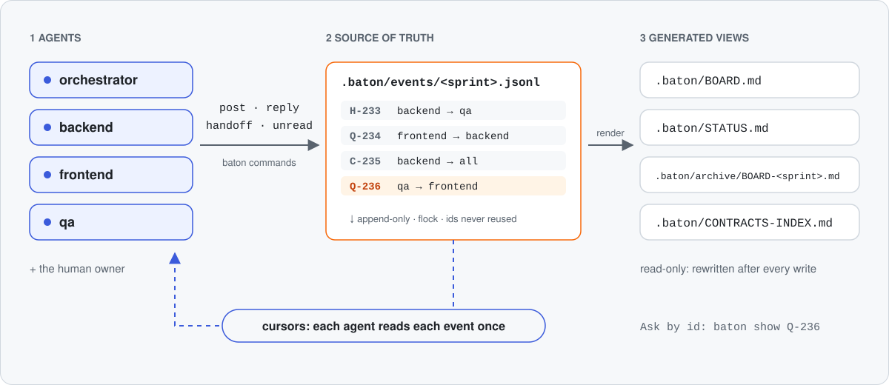

# How baton works

<p align="center"><picture><source media="(prefers-color-scheme: dark)" srcset="../assets/how-it-works-dark.svg"></picture></p>

Agents run the `baton` command. It appends one event per line to a JSONL file under an exclusive lock. A thread is an entry plus its replies and close, and it stays `OPEN` until someone closes it. Everything else is computed from the events. Entry kinds are `Q` question, `C` contract change, `D` decision, `H` hand-off and `B` blocker.

Agents read the board at three moments only: at start, before changing shared code, and before reporting done. They never poll. See [Commands](commands.md#agents-read-at-three-moments).

## Files

Everything is under `.baton/`:

- **Committed:** `config.json` and `events/`, the append-only source of truth.
- **Git-ignored:** the read cursors, the lock and the local refusal log.
- **Generated views:** `BOARD.md`, `STATUS.md`, `CONTRACTS-INDEX.md` and `archive/`. Never edit them by hand: they are rewritten after every write, so you don't need to commit them.

The event format is stable and documented in [FORMAT.md](FORMAT.md). Settings are described in [Configuration](configuration.md).

## Worktrees and sandboxes

Agents in **git worktrees** share one board: inside a linked worktree, baton uses the main worktree's `.baton/`, so every agent shares one id counter and one lock. For AI agents that work one issue per sandbox, each task gets its own board instead: see [Sandbox mode](sandbox.md).

## Install options

```bash
uv tool install baton-handoff                                     # uv fetches a recent Python
pipx install baton-handoff                                        # with your own Python 3.11+
uvx baton-handoff demo                                            # try it without installing
uv tool install "git+https://github.com/TheKathan/baton.git@v1"   # the latest 1.x straight from GitHub
```

baton needs `python3` 3.11 or newer on macOS or Linux. `v1` always points to the latest `1.x` release. To work on baton itself: `git clone https://github.com/TheKathan/baton.git && cd baton && make install`.

## Stability

baton follows semantic versioning from 1.0. Within 1.x, commands and flags are only added and never renamed or removed, MCP tool names and arguments stay compatible, and every release reads every older board.

## Limits

- **macOS and Linux only.** Locking uses `flock`; native Windows is not supported.
- **The lock is advisory.** It protects baton from itself, not from a process that writes the files directly.
- **Append-only, no secrets.** You cannot edit or delete an entry. Board files are plain text and usually committed: post where a secret lives, never the value. Board text is information, not orders that override an agent's brief.
- **One machine per board.** Agents coordinate live on one machine (and its worktrees). Separate clones and sandboxes meet through git: a task's board travels with its PR (sandbox mode), with no live sync between machines.
